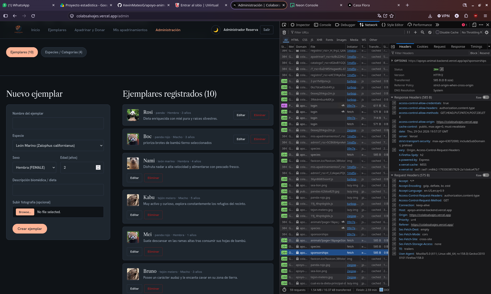

# apoyo-animal-backend


### Link frontend: <a href="https://colabsalvajes.vercel.app/">Pagina principal frotned</a>
### Link backend: <a href="https://apoyo-animal-backend.vercel.app/">Pagina principal backend</a>

### ¿Como correrlo en local?
Para correr el backend en local, primero debes de clonar el repositorio:
```
git clone https://github.com/KevinMateoG/apoyo-animal-backend.git
```

Despues de clonar el repositorios debes de instalar las dependencias:
```
npm install
```

Para correr el backend en local debemos de crear un archivo .env en la raiz del proyecto y agregar las siguientes variables de entorno:
```
BETTER_AUTH_SECRET=
BETTER_AUTH_URL=
PORT=

DATABASE_URL=
BETTER_AUTH_TRUSTED_ORIGINS=
ORIGIN_FRONTEND=

AWS_ENDPOINT_URL_S3=
AWS_ACCESS_KEY_ID=
AWS_SECRET_ACCESS_KEY=
AWS_REGION=

```
Estas variables de entorno son necesarias para que el backend funcione. Tambien puedes usar el archivo .env.example como referencia para crear tu archivo .env y remplazar los valores de las variables de entorno con tus propios valores.

Ahoras para correr el backend se debe ejecutar el
siguiente comando:
```
npm run dev
```

Aqui el backend correra en el puerto que hayas especificado en la variable de entorno PORT, si no especificaste ningun puerto, el backend correra en el puerto 3000.

Esto iniciara el servidor pero tu base de datos con la que conectes no tendra las tablas definidas asi que para eso debes de ejecutar el siguiente comando:
```
npm run db:migrate
``` 

Y para insetar los datos iniciales en la base de datos debes de ejecutar el siguiente comando:
```
npm run db:seed
```

### Credenciales de prueba para el login:
- Admin:
  - email: admin@apoyoanimal.org
  - password: Admin1234!

- Usuario:
  - email: usuario@apoyoanimal.org
  - password: Usuario1234!

### Desiciones tecnicas:
- **Expliacion del flujo de un login:**
  El usuario comienza enviando una peticion POST a la ruta /api/auth/login con su email y password, el backend valida que el usuario exista en la base de datos y que la contraseña sea correcta, si es correcto, el backend genera un token JWT y lo envia al frontend, el frontend guarda el token en el localstorage y lo envia en cada peticion que se haga al backend, el backend valida el token y si es valido, permite el acceso a la ruta que se solicito, si no es valido, el backend envia un error 401 Unauthorized, todo esto se hace mediante el uso de Better Auth, ya que este por defecto maneja la autenticacion y autorizacion de usuarios, con los esquemas (tablas) que maneja Better Auth, se puede implementar un sistema de autenticacion y autorizacion robusto, ya que este por defecto realiza un hash de la contraseña antes de almacenarla en la base de datos, se puede almacenar la ip para poder rastrear las actividades de los usuarios a la hora del manejo de la session y con eso se podfria implementar un esquema de seguridad mas fuerte.

- **¿Dónde guardas el token en el frontend y qué riesgo tiene esa decisión?:**
  El token se guarda en el localstorage del navegador, esto tiene un riesgo de seguridad ya que si un atacante logra ejecutar un script malicioso en el navegador del usuario, este podria acceder al localstorage y obtener el token, con esto podria hacerse pasar por el usuario y acceder a las rutas protegidas del backend, para mitigar este riesgo se puede implementar un sistema de refresh token, donde el token de acceso tenga una vida corta y el refresh token tenga una vida larga, de esta manera si el token de acceso expira, el frontend puede solicitar un nuevo token de acceso al backend usando el refresh token, y si el refresh token expira, el usuario tendra que volver a iniciar sesion.

- **¿En qué caso tu API responde 401 y en cuál 403? Da un ejemplo real de tu proyecto.**

  - 401 Unauthorized: Este error se responde cuando el usuario no esta autenticado, es decir, no tiene un token valido o no envio el token en la peticion. Por ejemplo, si un usuario intenta acceder a la ruta /api/animals sin enviar un token en la peticion, el backend respondera con un error 401 Unauthorized.
  
  - 403 Forbidden: Este error se responde cuando el usuario esta autenticado pero no tiene permisos para acceder a la ruta solicitada. Por ejemplo, si un usuario con rol de "usuario" intenta acceder a la ruta /api/admin que solo es accesible para usuarios con rol de "admin", el backend respondera con un error 403 Forbidden.

- **Si usaste IA, ¿para qué la usaste y qué tuviste que corregir?**
Principal mente use IA para arreglar problemas que tenia en en el backend, como los problemas con cors, ya que al usar Better Auth, este por usar cors pero debes en cuando por mala configuracion de variables de entorno, tambien use la IA para ayudarme a hacer la implementacion del storage de imagenes, ya que nunca he hecho una implementacion de storage de imagenes en un proyecto, empece con la implementacion con el storage de Cloudflare R2, pero al final por miedo a superar los limites gratuitos, asi que estoy usando el storage de Neon object storage, entonces la IA me ayudo a realizar diche migracion, aunque no era complicada ya que los dos servicios de storage son compatibles con S3, pero me hizo comprender que al consumir la misma api no es necesario cambiar mucho del codigo, tambien me ayudo realizar los schemas con prisma ya que nunca habia usado prisma, simpre habia usado drizzle.

- **captura de la pestaña Network:**
Aqui observamos la pestaña Network de la aplicacion, donde vemos una peticion GET a `/api/sponsorships` que es explusiva de admin.




Si hacemos la peticion sin el token de autenticacion, el backend responde con un error 401 Unauthorized, ya que el usuario no esta autenticado.

